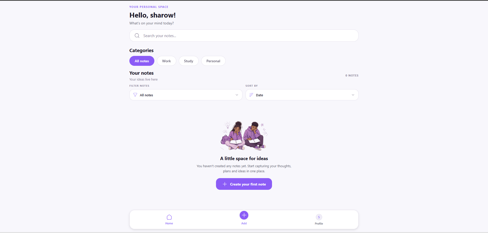
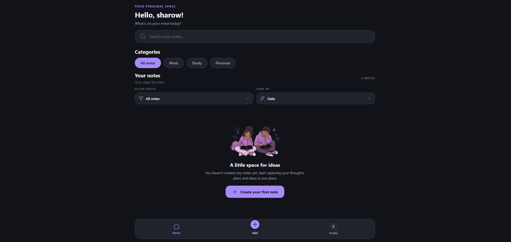

# Notes App

A cross-platform Notes App built with **React Native and Expo**. It allows users to create, manage, organise, search, and sort personal notes through a clean interface with light and dark themes.

## Preview

### Light Mode


### Dark Mode


## Download

**[Download NotesApp for Android](https://drive.google.com/drive/folders/1Ww6tgZWx6GwoUKp5_XPahoED8ugeJzrH?usp=sharing)**

Download the Android APK from the Google Drive folder and install it on your Android device.

## Features

### User Authentication

- Register with a full name, username, email address, and password.
- Log in using registered credentials.
- Protected navigation for authenticated users.
- Sign out with a confirmation dialog.
- Password strength validation.

### Notes Management

- Create notes with a title and content.
- Assign notes to Work, Study, or Personal categories.
- View all saved notes.
- Edit existing notes.
- Delete notes with confirmation.
- Track when notes were created and last updated.

### Search and Sorting

- Search notes by words in their titles, content, and categories.
- Filter notes by category.
- Sort notes by newest, oldest, or name.

### Profile Management

- View and update personal information.
- Change username and full name.
- Change account password.
- View registered email address.

### Appearance and Design

- Light and dark mode.
- Theme preference is saved between app sessions.
- Responsive interface for web and mobile.
- Hugeicons for consistent icon design.

## Technologies Used

| Technology              | Purpose                                |
| ----------------------- | -------------------------------------- |
| React Native            | Cross-platform application development |
| Expo                    | Development and application tooling    |
| TypeScript              | Type-safe development                  |
| Expo Router             | File-based navigation                  |
| AsyncStorage            | Local data persistence                 |
| Hugeicons               | Application icons                      |
| React Native Reanimated | Animation support                      |

## Getting Started

### Prerequisites

Install the following before running the application:

- [Node.js](https://nodejs.org/)
- npm (included with Node.js)
- [Visual Studio Code](https://code.visualstudio.com/) (recommended)
- Expo Go for testing on a physical mobile device, where compatible with the installed Expo SDK.

### Installation

1. Clone the repository:

   ```bash
   git clone https://github.com/Sharon-Mashai/NotesApp.git
   ```

2. Navigate into the project folder:

   ```bash
   cd NotesApp
   ```

3. Install dependencies:

   ```bash
   npm install
   ```

### Running the Application

Start the Expo development server:

```bash
npx expo start
```

You can also run the application using the following commands:

**Web:**

```bash
npm run web
```

**Android:**

```bash
npm run android
```

**iOS:**

```bash
npm run ios
```

Follow the Expo instructions displayed in the terminal to open the application.

## Data Storage

The application uses **AsyncStorage** to store account information, notes, and appearance preferences locally.

Data is stored on the device or browser where the application is running. Web and Android installations use separate local storage, so data does not automatically synchronise between platforms.

## Usage

1. Create an account using the registration screen.
2. Log in with your credentials.
3. Create notes and assign them to a category.
4. Use the dashboard to search, filter, and sort your notes.
5. Open the category pages to view notes organised by Work, Study, or Personal.
6. Edit or delete notes when necessary.
7. Manage your account and appearance preferences through Settings and Profile.

## Author

**Sharon Mashai**

GitHub: [Sharon-Mashai](https://github.com/Sharon-Mashai)

---

Developed as a React Native Notes App project.
